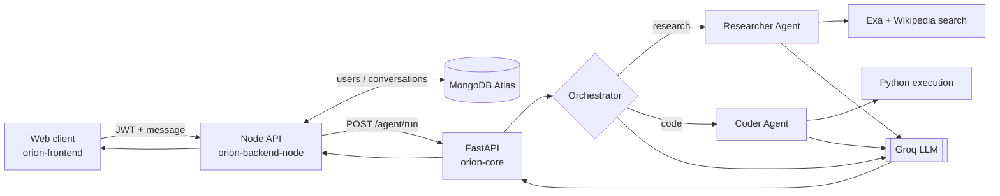

# 🛰️ Orion — Multi-Agent AI System

Orion is a multi-agent AI system built around the ReAct pattern (Thought → Action → Observation). A query comes in, an LLM-based orchestrator decides whether it needs research or code execution, and a specialist agent handles it using real tools — web search, webpage extraction, or Python execution — rather than just generating text. For multi-step requests, a Planner breaks the query into a task list and routes each step through the same pipeline.

The project is also a working example of taking a single-user CLI prototype and rebuilding it for multi-user web use: the original agents were refactored to be stateless, wrapped in a FastAPI service, and put behind a Node.js/Express layer that owns authentication (JWT) and persistence (MongoDB) — so conversation history survives across requests without leaking between users. A Vite-served web client sits on top and talks only to the Node API.

## Architecture



The Node API is the only thing a client talks to. It authenticates the request, loads conversation history from MongoDB, and forwards the query to the Python API, which routes it to the right agent and returns a plain-text answer. A full request-by-request walkthrough lives in [`REPOSITORY_GUIDE.md`](./REPOSITORY_GUIDE.md).

## Concepts implemented

- ReAct-style tool use via native function/tool calling
- LLM-based task routing across specialist agents
- Plan → Execute decomposition for multi-step requests
- Stateless agent design for safe multi-user, concurrent use
- Conversation memory with automatic summarization
- Persisted, authenticated multi-user chat (JWT + MongoDB)

## Tech stack

**Python — `orion-core/`**
- FastAPI + Uvicorn — HTTP interface consumed by the Node backend
- Groq (`openai/gpt-oss-20b`), via an OpenAI-compatible client — LLM inference
- Exa API, with a Wikipedia fallback — web search
- trafilatura, with a BeautifulSoup fallback — webpage content extraction
- Streamlit — local single-user UI (legacy — see Known Limitations)
- SpeechRecognition + pyttsx3 — optional local voice I/O for `main.py` only (not used by the deployed API)

**Node.js — `orion-backend-node/`**
- Express — HTTP server
- MongoDB Atlas + Mongoose — users, conversations, messages
- JWT + bcrypt — authentication

**Frontend — `orion-frontend/`**
- Vanilla JavaScript single-page app with hash routing, served by Vite
- Pages: landing, login/signup, chat, agents, settings
- The Vite dev server proxies `/auth`, `/chat` and `/conversations` to the Node API — it never calls the Python service directly

## Project structure

```
Orion/
├── orion-core/                 # Python AI engine
│   ├── api/server.py           # FastAPI wrapper — GET /, POST /agent/run
│   ├── src/
│   │   ├── agents/             # orchestrator, researcher, coder
│   │   ├── tools/              # search, webpage fetch, code runner, calculator
│   │   ├── content_agent/      # experimental: GitHub activity → social post drafts (WIP)
│   │   ├── client.py           # LLM client (Groq, OpenAI-compatible)
│   │   ├── memory.py           # conversation memory + summarization
│   │   └── planner.py          # multi-step plan → execute
│   ├── tests/                  # unit tests (content_agent collector)
│   ├── main.py                 # CLI, with optional voice I/O
│   ├── app.py                  # Streamlit UI (legacy — see Known Limitations)
│   └── requirements.txt
├── orion-backend-node/         # Node.js auth + persistence API
│   ├── server.js               # entry point — mounts /auth, defines /chat and /conversations
│   ├── middleware/auth.js      # JWT verification
│   ├── routes/auto.js          # POST /auth/signup, POST /auth/login
│   └── model/                  # User, Conversation, Message (Mongoose)
├── orion-frontend/             # Vite web client
│   ├── index.html
│   ├── vite.config.js          # dev server + proxy to the Node API
│   └── src/                    # router, API wrapper, auth helpers, pages/
├── docker-compose.yml          # runs all three services together
└── REPOSITORY_GUIDE.md         # full file-by-file walkthrough
```

## Node API endpoints

| Method | Path | Auth | Purpose |
|---|---|---|---|
| POST | `/auth/signup` | — | Create an account |
| POST | `/auth/login` | — | Get a JWT |
| POST | `/chat` | JWT | Send a message (creates or continues a conversation) |
| GET | `/conversations` | JWT | List your conversations |
| GET | `/conversations/:id/messages` | JWT | Load a conversation's messages |
| DELETE | `/conversations/:id` | JWT | Delete a conversation |

## Getting started

Orion runs as three services: the Python API, the Node API, and the web client. Start them in that order — each one expects the one before it to be reachable.

### Environment files

Create `orion-core/.env`:

```
GROQ_API_KEY=your-groq-key
EXA_API_KEY=your-exa-key
# only needed for the experimental content_agent:
GITHUB_TOKEN=your-github-token
```

`GROQ_API_KEY` and `EXA_API_KEY` are required — the search tool reads `EXA_API_KEY` at import time, so the API fails to start without it. Get a Groq key at [console.groq.com](https://console.groq.com) and an Exa key at [exa.ai](https://exa.ai).

Create `orion-backend-node/.env`:

```
MONGO_URI=your-mongodb-atlas-uri
JWT_SECRET=any-long-random-string
PORT=5000
ORION_BACKEND_URL=http://127.0.0.1:8000
```

`ORION_BACKEND_URL` is the base URL of the Python API — the Node server appends `/agent/run` itself, so don't include it. The server refuses to start without `MONGO_URI` and `JWT_SECRET`.

### Option A — Docker Compose

From the repo root, with both `.env` files in place:

```bash
docker compose up --build
```

The web client is at http://localhost:5173, the Node API at http://localhost:5000, and the Python API at http://localhost:8000. Compose overrides `ORION_BACKEND_URL` and the frontend's proxy target so the containers reach each other by service name.

### Option B — Run each service locally

**1. Python API (`orion-core/`)**

```bash
cd orion-core
python -m venv venv
venv\Scripts\activate        # Windows
# source venv/bin/activate   # macOS/Linux
pip install -r requirements.txt
uvicorn api.server:app --reload --port 8000
```

**2. Node API (`orion-backend-node/`)**

```bash
cd orion-backend-node
npm install
node server.js
```

**3. Web client (`orion-frontend/`)**

```bash
cd orion-frontend
npm install
npm run dev
```

Open http://localhost:5173, sign up, and start chatting. To test the API without the UI, use `POST /auth/signup` → `POST /auth/login` → `POST /chat` with the returned JWT as a Bearer token.

### Running tests

```bash
cd orion-core
python -m unittest discover tests
```

## Content agent (experimental)

`orion-core/src/content_agent/` is a work-in-progress CLI that turns your recent GitHub activity into a draft social post. It collects events from an allowlist of repos, asks you a few follow-up questions, writes a draft, checks it for unsupported claims, and lets you revise it.

```bash
cd orion-core
python -m src.content_agent.cli activity   # list recent activity
python -m src.content_agent.cli            # interactive post flow
```

It needs `GROQ_API_KEY` and `GITHUB_TOKEN` in `orion-core/.env`. It isn't connected to the API or the web client yet, and approved posts aren't saved or published anywhere.

## Known limitations & roadmap

- **The Streamlit UI (`app.py`) is currently broken.** It calls an `Orchestrator.run()` method that no longer exists after the routing refactor. Use the CLI (`main.py`), the web client, or the API directly until it's reconnected to the `route → memory → run_route` flow.
- **The code-execution tool isn't sandboxed.** `run_python_code` runs on the host process with no OS-level isolation, resource limits, or network restriction. Don't expose `/agent/run` publicly without adding real isolation first.
- **The frontend only runs through the Vite dev server.** API calls rely on its proxy, so a static `vite build` needs a reverse proxy (or a configurable API base URL) in front of it.
- **Test coverage is minimal.** Only the content agent's collector has unit tests; the agents, API and Node backend have none.
- **Next up:** finish the content agent → RAG + a fine-tuned model (v3) → a standalone agent-debugger/tracer tool for observability.

## Learn more

For a file-by-file walkthrough of how a request actually moves through the system, see [`REPOSITORY_GUIDE.md`](./REPOSITORY_GUIDE.md).

## Author

**Shivansh Gupta**
B.Tech CSE (AI/ML) — Lovely Professional University
GitHub: [@shivansh-arch](https://github.com/shivansh-arch)
